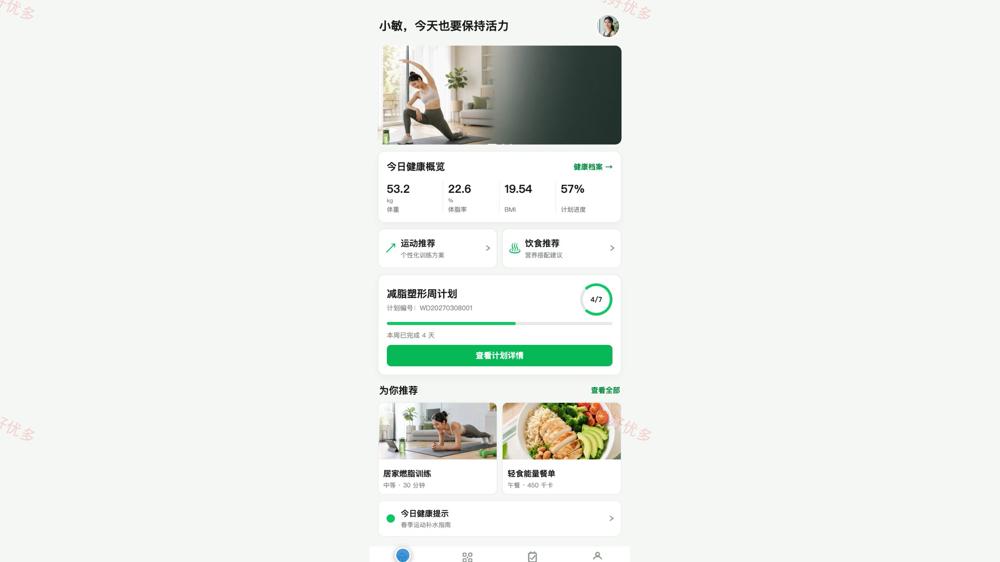
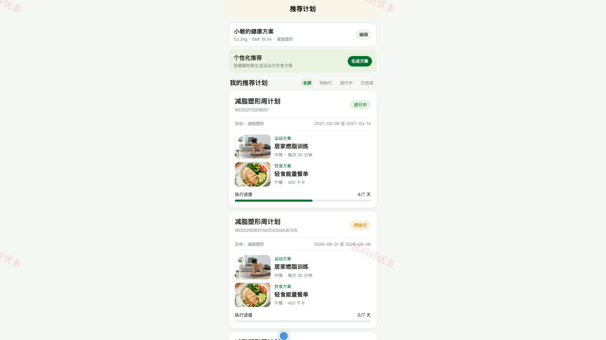
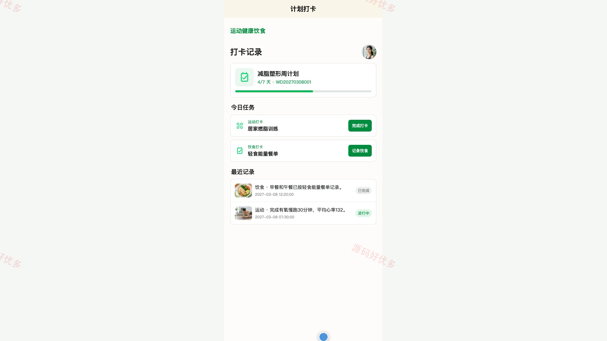
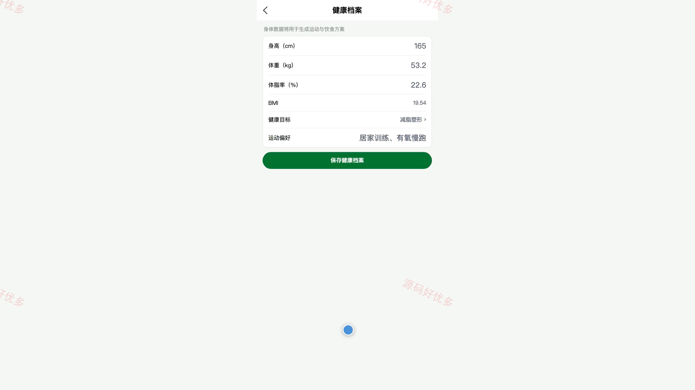
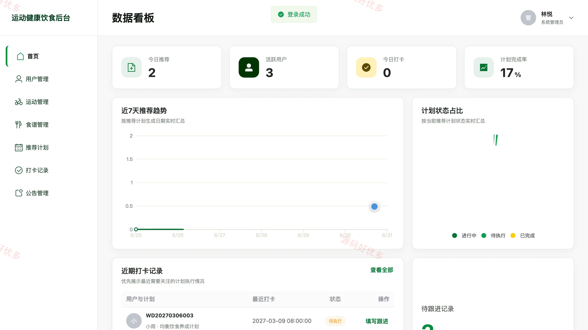
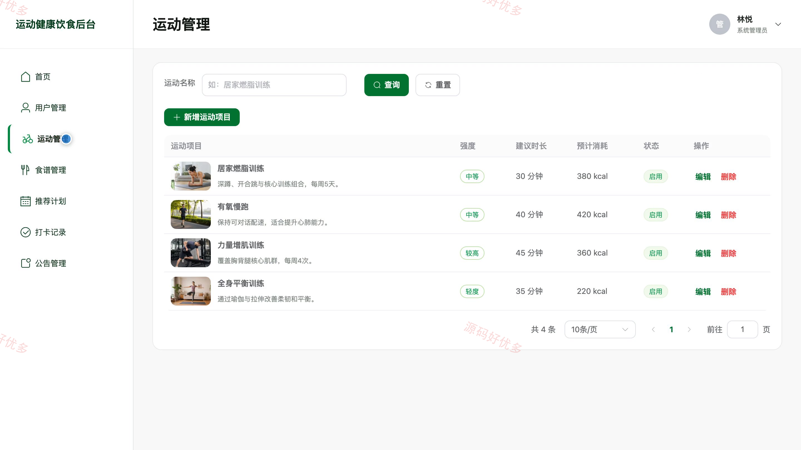
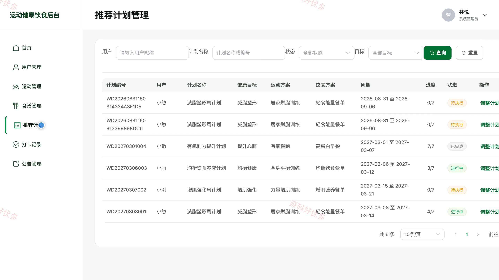
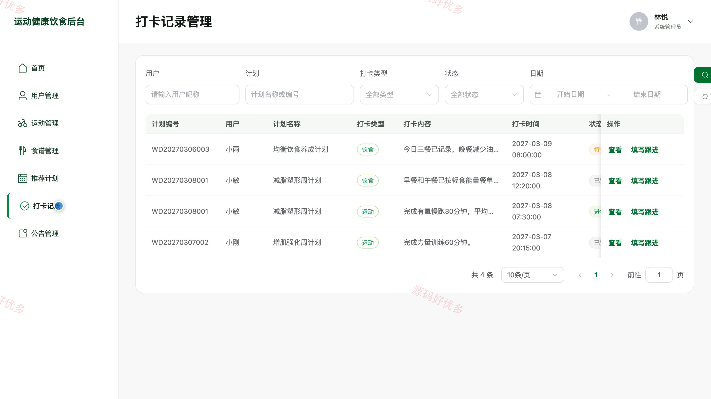

## 源码问题查看主页咨询

### 一、关键词
个人健康管理、运动打卡、饮食计划、营养健康、健身计划

### 二、作品包含
源码+数据库+万字设计文档+PPT+全套环境和工具资源+本地部署教程

### 三、项目技术
前端技术： Html、Css、Js、Vue3.4、Element-Plus、uniapp
后端技术：Java、SpringBoot3.2.5

### 四、运行环境（以下版本亲测，其他版本兼容性请自行测试）
开发工具：IDEA/eclipse + VSCODE + HBuilder X + 微信开发者工具

数据库：MySQL5.7+（共10张表）

数据库管理工具：Navicat10以上版本

环境配置软件： JDK17 + Maven3.6

前端Nodejs：20

浏览器：谷歌浏览器

### 五、项目介绍
项目编号：bs011B

本系统面向个人运动与饮食健康管理场景，用户可在小程序端维护健康档案，生成并启动七天运动饮食计划，完成运动饮食打卡、查看记录与健康公告；管理员可在网页后台维护用户、运动项目、饮食食谱、推荐计划、打卡记录与公告内容。

角色：用户、管理员

用户功能：注册登录、健康档案维护、个性化七天计划生成、推荐计划查看及启动、运动饮食打卡、打卡记录查询、健康公告查看、个人资料及密码维护。

管理员功能：后台登录及安全退出、用户账号管理、运动项目管理、饮食食谱管理、推荐计划管理、打卡记录跟进、健康公告管理、管理员资料及密码维护。

### 六、运行截图

